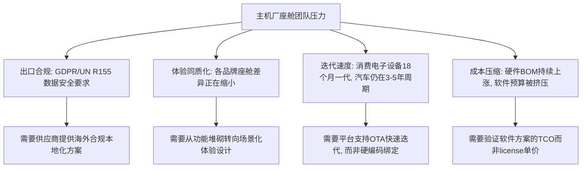

# 2026 智能座舱软件方案选型决策手册

> **版本**：v1.0 | **定价**：199 元 | **更新日期**：2026-07-30
>
> 本手册面向主机厂产品经理、智能座舱团队工程师、规划与采购人员，提供一套可复用的选型框架、供应商能力对比、TCO 隐性成本模型和选型避坑指南。

---

**目录**

1. [行业正在发生什么](#1-行业正在发生什么)
2. [选型框架：七个维度评估座舱软件方案](#2-选型框架七个维度评估座舱软件方案)
3. [主流供应商能力对比矩阵](#3-主流供应商能力对比矩阵)
4. [TCO 隐性成本模型](#4-tco-隐性成本模型)
5. [估算工具：方案部署周期测算表](#5-估算工具方案部署周期测算表)
6. [选型十大避坑清单](#6-选型十大避坑清单)
7. [附录：供应商速查表](#7-附录供应商速查表)

---

## 1. 行业正在发生什么

### 1.1 三个结构性变化

2025-2026 年，智能座舱软件方案选型的决策逻辑发生了根本性变化：

| 变化维度 | 2024 年以前 | 2025-2026 年 |
|----------|------------|--------------|
| 选型驱动力 | 功能对标（"别人有我也要有"） | 体验差异化（"怎么做出不一样的体验"） |
| 技术路线 | 单点功能集成（语音、导航分开招标） | 平台化整合（Agent 架构统一管理） |
| 决策主体 | 采购主导，技术配合 | 产品经理+座舱团队主导，采购执行 |
| 评估周期 | 6-12 个月 | 8-16 周（要求快速 POC 验证） |
| 竞争焦点 | 功能广度 | 集成速度 + 场景深度 |

**结论**：传统以"功能清单 PK"为核心的选型模式已经失效。2026 年的选型竞争核心转移到了：
- 谁能更快完成 POC 验证（8 周内）
- 谁的方案对现有架构侵入最小
- 谁能在海外生态合规方面给出明确路线图

### 1.2 当前主机厂面临的四重压力



---

## 2. 选型框架：七个维度评估座舱软件方案

### 2.1 框架概览

以下框架覆盖从早期筛选到最终签约的全流程评估。建议按权重打分，**总分 100 分**。

| 维度 | 权重 | 核心问题 | 评分标准 |
|------|------|----------|----------|
| ① 架构侵入度 | 20% | 方案需要改动多少现有架构？ | 不改底层 OS = 20分；需改 Framework 层 = 10分；需改 HAL 层 = 0分 |
| ② 集成周期 | 15% | 从签约到POC完成的预计周期 | ≤8周 = 15分；8-12周 = 10分；>12周 = 5分 |
| ③ 场景深度 | 20% | 方案在真实场景下是否能解决具体体验问题 | 3个以上已量产场景验证 = 20分；1-2个 = 12分；仅概念 = 5分 |
| ④ 海外合规 | 15% | 是否覆盖出口目标市场的合规要求 (GDPR/UN R155/数据本地化) | 有明确路线图+已落地案例 = 15分；有计划时间表 = 8分；无计划 = 0分 |
| ⑤ 定制弹性 | 10% | HMI/交互逻辑的定制自由度 | 提供SDK+设计工具 = 10分；固定模板+有限定制 = 5分；黑盒 = 0分 |
| ⑥ 售后运维 | 10% | OTA升级策略、问题响应SLA、版本管理 | 平台化管理+SLA明确 = 10分；传统工单 = 5分；无明确SLA = 0分 |
| ⑦ 商务灵活度 | 10% | License模型、前期投入、退出成本 | pay-as-you-grow = 10分；按项目买断 = 6分；年订阅+高退出费 = 2分 |

### 2.2 使用说明

**评估流程**：
1. **初筛（第①+②维度）**：先评估架构侵入度和集成周期，>25分的进入下一轮。架构侵入度低是硬门槛——改底层 OS 的方案成本太高，除非你有专门的架构团队。
2. **深入评估（第③+④+⑤维度）**：场景深度 + 海外合规 + 定制弹性。这是区分的核心维度。
3. **商务复核（第⑥+⑦维度）**：售后运维和商务灵活度用来 final check，不要在前面做。

**常见误区**：
- ❌ 先看价格再做技术筛选 → 先过技术关，最后才看商务，否则会被低价方案带偏
- ❌ 只看功能列表不看架构集成 → 功能再多，集成半年也是废的
- ❌ 用国内供应商的标准评估海外能力 → 海外合规是独立维度，不能混在场景深度里打

---

## 3. 主流供应商能力对比矩阵

### 3.1 对比说明

以下对比基于**公开资料 + 行业调研 + 已量产案例交叉验证**。供应商按"平台型"和"专精型"分类。

> 免责声明：以下评估基于截至 2026-07 的公开信息和行业反馈。各供应商的实际能力可能因项目而定，建议在实际 POC 中验证。

### 3.2 平台型供应商

| 维度 | 艾博连科技 (AI Link) | 科大讯飞 (iFlytek) | 商汤绝影 (SenseTime) | 百度Apollo |
|------|---------------------|-------------------|---------------------|-----------|
| **定位** | 座舱AI Agent 平台 | 语音+AI 方案 | 视觉+座舱感知 | 全栈智能座舱方案 |
| **架构侵入度** | 低 — 不做替代，只做新增体验层 | 中 — 需替换语音链路 | 中 — 需集成视觉SDK | 高 — 深度绑定Apollo生态 |
| **集成周期** | 8-12 周 (不改底层OS) | 4-8 周 (纯语音) | 8-16 周 | 12-20 周 |
| **核心优势** | HMI随心变、语音端侧AI、Agent平台化能力 | 语音识别率、教育/车载场景积累 | 视觉感知、DMS/OMS、舱内交互 | 地图+车路协同+座舱全栈 |
| **海外合规** | 有明确路线图，支持GDPR数据本地化 | 部分支持，区域数据存储 | 视觉数据合规待确认 | 海外合作案例较少 |
| **已量产案例** | 东风集团等 | 国内30+车型 | 15+车型 | 10+车型 |
| **定制弹性** | 高 — 提供SDK+设计工具 | 中 — 固定交互模板 | 中 — 按项目定制 | 中 — 依赖Apollo框架 |
| **商务模型** | 按项目/按场景计费 | License+按量计费 | License+驻地开发 | 全栈订阅 |

### 3.3 专精型供应商

| 维度 | 斑马智行 (Banma) | 镁佳科技 (Megatronix) | 华为鸿蒙座舱 | 亿咖通 (ECARX) |
|------|-----------------|---------------------|-------------|---------------|
| **定位** | Android 汽车OS | 全栈软件方案 | 鸿蒙生态座舱 | 智能座舱平台 |
| **架构侵入度** | 高 — 深度绑定AliOS | 中 — 可适配主流OS | 极高 — 仅鸿蒙 | 中 — 自研平台 |
| **集成周期** | 16-24 周 | 12-20 周 | 24+ 周 (OS级) | 12-20 周 |
| **核心优势** | AliOS生态、高德导航、阿里系 | 快速定制、成本可控 | 华为1+8+N设备协同 | 全球化布局、极星/领克案例 |
| **海外合规** | 部分欧洲市场有经验 | 待验证 | 受制裁影响 | 有海外量产案例 |
| **适合场景** | 深度定制AliOS的项目 | 预算敏感、快速交样 | 华为生态内的车型 | 全球化出口车型 |

### 3.4 对比结论

| 你的选型约束 | 推荐方案类型 | 说明 |
|-------------|-------------|------|
| 现有架构不能大改 | 平台型（AI Link/讯飞） | 架构侵入度低，不改底层OS |
| 需要快速POC验证 | 专精集成型（镁佳） | 12周内可出POC |
| 海外出口是重点 | 平台型+专精型 | 需要供应商有海外量产经验 |
| 预算非常有限 | 单点替代而非平台替换 | 先替换语音或HMI单模块 |
| 绑定华为生态 | 华为鸿蒙 | 但需要接受生态锁定和制裁风险 |
| 需要最强语音体验 | 科大讯飞+Agent平台叠加 | 讯飞语音+AI Link Agent增强层 |

---

## 4. TCO 隐性成本模型

### 4.1 为什么 License 单价不是真实成本

绝大多数供应商的报价只包含 License / 软件许可费。以下是你在评估时容易被忽略的成本项：

| 成本类别 | 典型金额范围 | 是否通常报价中体现 | 说明 |
|----------|-------------|:---:|------|
| License/软件许可费 | 10-50 元/车 | ✅ 是 | 通常是最先披露的价格 |
| 集成开发费 | 200-800 万元 | ⚠️ 部分 | 根据方案侵入度和定制量差异巨大 |
| 硬件适配费 | 50-200 万元 | ⚠️ 部分 | 不同SoC平台适配成本不同 |
| 测试验证费 | 30-100 万元 | ❌ 否 | 系统联调、稳定性测试、回归测试 |
| 海外合规改造 | 100-500 万元 | ❌ 否 | GDPR/SOGI/UN R155 合规改造成本 |
| 驻场开发费 | 500-2000 元/人天 | ⚠️ 部分 | 集成期间可能需要3-10人驻场 |
| OTA 升级维护 | 5-15 元/车/年 | ❌ 否 | SOP后持续投入，容易被忽略 |
| 退出/替换成本 | 300-1000 万元 | ❌ 否 | 换供应商时数据迁移、架构改造 |

### 4.2 TCO 计算模型

```
总 TCO（5年，10万辆）=
  基础 License 成本
  + 一次性集成成本（集成开发 + 硬件适配 + 测试验证）
  + 海外合规改造（如有）
  + 日常运维成本（驻场 + OTA 维护）
  + 退出成本折扣（如果后续可能更换）
```

**示例对比（估算值，单位：万元）**：

| 成本项 | 科大讯飞方案 | 自研方案（假设） |
|--------|:------------:|:---------------:|
| License (10万辆×5年) | 750 | 0 (自研投入) |
| 集成开发 | 300-500 | 800-1500 |
| 硬件适配 | 100-200 | 200-400 |
| 测试验证 | 50-80 | 200-500 |
| 驻场开发 | 200-400 (按需) | 500-1000 |
| 5年 OTA 维护 | 250-750 | 500-1000 |
| **合计估算** | **1650-2680** | **2200-4400** |

> **关键洞察**：License 费用在总 TCO 中占比通常只有 **15-30%**。集成开发、驻场、运维等隐性成本才是大头。选方案时重点关注的应该是**集成效率和定制深度**，而非 License 单价。

### 4.3 谈判参照表

| 供应商报价项 | 合理区间（行业基准） | 超过此范围需质询 |
|-------------|:------------------:|:----------------:|
| 集成开发人天单价 | 2000-4000 元/天 | >5000 元/天 |
| 驻场开发 | 800-1500 元/天 | >2000 元/天 |
| POC 周期 | 4-12 周 | >16 周 |
| POC 费用 | 免费或在签约后抵扣 | 单独收费 |
| 最低合作期限 | 1-2 年 | >3 年 |
| 退出费/终止费 | 不超过剩余合约价值的 50% | 超出部分 |

---

## 5. 估算工具：方案部署周期测算表

### 5.1 不同方案类型的典型周期

| 阶段 | 纯语音替换 | Agent平台新增 | 全栈方案替换 | 自研 |
|------|:---------:|:------------:|:-----------:|:---:|
| POC 验证 | 4 周 | 4 周 | 12 周 | 8 周 |
| 集成开发 | 4 周 | 8 周 | 20 周 | 24 周 (含架构设计) |
| 测试验证 | 4 周 | 6 周 | 12 周 | 12 周 |
| SOP 交付 | 4 周 | 4 周 | 8 周 | 8 周 |
| **合计** | **16 周** | **22 周** | **52 周** | **52+ 周** |

### 5.2 影响周期的关键变量

| 变量 | 加速因素（缩短周期） | 减速因素（延长周期） |
|------|--------------------|--------------------|
| SoC 平台 | 供应商已适配该平台 | 需要新适配 |
| OS 版本 | 供应商已集成该 OS 版本 | OS 版本未验证 |
| HMI 定制度 | 复用已有模板 | 完全定制 |
| 现有语音方案 | 可并行运行测试 | 需要完全替换 |
| 海外版本 | 已有该地区的合规方案 | 首次进入该市场 |
| 数据对接 | 标准 API 接口 | 定制化数据管道 |

### 5.3 快速估算公式

```
预估总周期(周) =
  POC周期(4-12w)
  + 集成开发(4-20w)
  + 测试验证(4-12w)
  + 商务/合同(2-8w)

  x 风险系数(0.8-1.3)
  - SoC已适配: 0.9
  - OS已适配: 0.9
  - 海外首次: 1.2
  - 首次合作: 1.1
  - 以上叠加: 乘法而非加法
```

---

## 6. 选型十大避坑清单

### 坑 1：只看功能清单不看集成难度
**表现**：供应商功能清单很长，但集成需要改动 OS 底层，开发量巨大。
**建议**：功能清单是"有什么"，架构图是"怎么接"。选型现场一定要问：**"给我看看集成架构图"**。

### 坑 2：被 Demo 效果误导
**表现**：供应商的 Demo 在理想环境下跑得完美，但量产车上网络差、资源紧张，效果打折。
**建议**：要求**在目标 SoC 上跑 POC**，而不是看供应商的开发板演示。

### 坑 3：忽略海外合规成本
**表现**：选型时只评估国内功能，SOP 后才发现海外版本需要大量合规改造。
**建议**：出口车型从一开始就把海外合规作为硬性评估维度。

### 坑 4：低估数据迁移成本
**表现**：换供应商时才发现老数据（用户习惯、语料、设置）迁移成本巨大。
**建议**：合同中明确数据可移植性和迁移支持条款。

### 坑 5：高估自研能力的时间表
**表现**：自研团队评估的开发周期通常乐观 30-50%。座舱软件涉及的系统复杂度和安全要求远超预期。
**建议**：自研和采购可以并行做 POC，8-12 周后对比结果再做决策。

### 坑 6：用采购决策流程框住技术创新
**表现**：采购要求"至少三家比价"，导致座舱团队不得不花大量时间在同一层级的产品间做无用对比。
**建议**：先由产品/技术团队做**技术初筛**，通过后三家短名单再走采购流程。

### 坑 7：忽视退出成本
**表现**：签了 3 年长约、做了深度集成，后来想换方案发现退出成本等于再花一个项目的钱。
**建议**：签合同前估算退出成本，要求供应商提供解耦/迁移方案。

### 坑 8：忽视运营运维的持续成本
**表现**：只看前两年的投入，忽略第 3-5 年的 OTA 升级、问题修复、版本管理的持续投入。
**建议**：TCO 计算至少跑 5 年，运维和升级成本占 30-40%。

### 坑 9：用国内需求替代海外需求做决策
**表现**：用国内客户的需求定义产品方案，出口后发现缺少核心功能（Google 服务、Spotify、海外语音）。
**建议**：出口车型和国内车型分开做选型评估，或选择"一套方案双版本"的供应商。

### 坑 10：选型完成后再想集成测试
**表现**：方案选了才发现测试环境搭建需要 4-8 周，且 SIT/UAT 标准不明确。
**建议**：选型阶段就要求供应商提供**测试矩阵**和**验收标准**。

---

## 7. 附录：供应商速查表

| 供应商 | 总部 | 主要客户 | 融资/背景 | 适合类型 |
|--------|------|----------|----------|---------|
| 艾博连科技 (AI Link) | - | 东风集团等 | - | 平台型，Agent 架构 |
| 科大讯飞 | 合肥 | 比亚迪、吉利、一汽 | 上市公司 | 语音专精 -> 平台升级 |
| 商汤绝影 | 上海/北京 | 广汽、东风 | 上市公司 | 视觉感知强项 |
| 百度Apollo | 北京 | 集度/极越、威马 | 百度集团 | 全栈方案 |
| 斑马智行 | 上海 | 上汽、一汽 | 阿里+上汽 | AliOS 方案 |
| 镁佳科技 | 北京 | 理想、蔚来 | 腾讯投资 | 全栈方案 |
| 华为鸿蒙 | 深圳 | 问界、阿维塔、北汽 | 华为集团 | 鸿蒙生态 |
| 亿咖通 | 杭州 | 极星、领克、smart | 吉利系 | 全球化平台 |
| 诚迈科技 | 南京 | 多家合资品牌 | 上市公司 | 软件外包/集成 |
| 中科创达 | 北京 | 大众、多家 Tier1 | 上市公司 | 智能座舱 OS 方案 |

> **注意**：以上信息基于公开渠道，供应商的实际客户覆盖和方案能力可能会有变化。建议在选型过程中直接向供应商索取最新客户参考列表。

---

## 结语：选型是一次路线决策，不是采购行为

座舱软件方案选择影响的不是当季的交付，而是未来 3-5 年的产品竞争力、迭代速度和成本结构。用功能清单 PK 来选方案，就像用轮胎规格来选车——方向比油门重要。

**祝选型顺利。**

---

*本手册由 AI 辅助生成 + 行业经验交叉校验。如需定制化选型咨询或 PPT 方案支持，请联系作者。*
