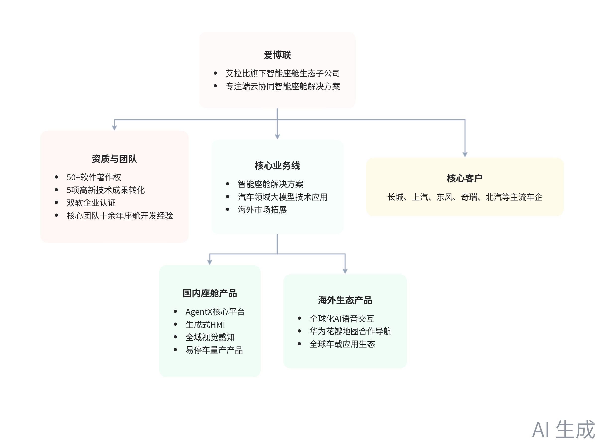
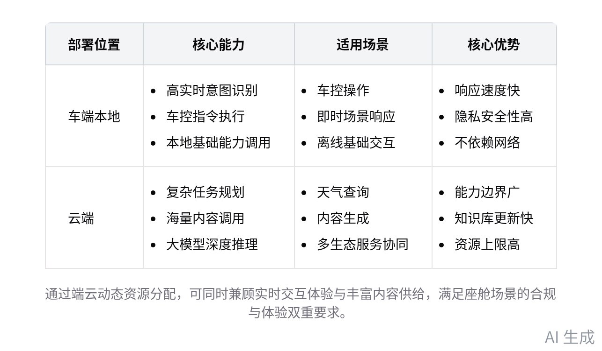
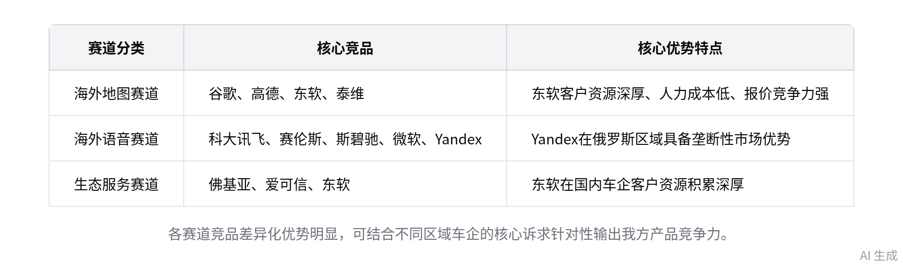

# 艾博连 公司产品业务培训学习笔记

> 会议主题：公司产品介绍
> 会议时间：2026-08-04（周二）14:31 - 15:54
> 参会人：商雨、白雾、洪梓晴、康维庆
> 原始纪要：`/Users/kangweiqing/Desktop/智能纪要：公司产品介绍 2026年8月4日/智能纪要：公司产品介绍 2026年8月4日.md`
> 飞书原文：[公司产品介绍 2026年8月4日](https://abupdate.feishu.cn/docx/JmaHdDmdEobu2BxoUQWcRH03nih)

> AI 会议纪要可能存在误差。对外介绍公司定位、资质、量产案例和商务口径前，应找产品/商务负责人二次确认。

## 一、公司概况

**一句话定位**：艾博连是艾拉比（主营 OTA）旗下子公司，专注智能座舱生态研发，提供可量化、可进化、可量产、全合规的端云协同智能座舱解决方案。

### 基本盘

| 维度 | 口径 |
|------|------|
| 资质 | 50 余项软件著作权、5 项高新技术成果转化、官方认证双软企业 |
| 团队 | 核心团队普遍具备十余年座舱软件开发经验 |
| 总部 | 上海 |
| 分支机构 | 合肥、重庆、深圳、武汉、北京 |
| 核心团队 | 研发、测试、项目核心团队集中于深圳 |
| 东风支持 | 武汉团队主要服务东风客户 |

### 业务方向与客户

- 三大业务线：智能座舱解决方案、汽车领域大模型技术应用、海外市场拓展。
- 建立全球化合作伙伴网络。
- 已与长城、上汽、东风、奇瑞、北汽等国内主流车企建立合作。
- 同时布局海外车企出海项目的配套服务。

## 二、国内智能座舱产品矩阵

### AgentX 核心平台

- 公司核心技术壁垒。
- 将外部生态服务做工程化、平台化统一封装。
- 支持接入后自我迭代。
- 覆盖意图理解、任务编排、交互呈现全链路。

### 端云协同架构

- 端侧：高实时、高隐私需求的车控、即时意图识别。
- 云端：复杂任务规划、海量内容调用。
- 动态分配资源，兼顾体验与合规。

### 核心技术能力

- 多模态感知。
- 长短期记忆协同：短期记忆覆盖即时场景数据，长期记忆沉淀用户偏好。
- 主动式个性化服务。

### 主要产品

| 产品/能力 | 核心卖点 | 负责人/状态 |
|-----------|----------|-------------|
| 生成式 HMI | 大模型生成静态/动态壁纸、3D 车模、界面布局；智慧场景引擎一句话触发 | 对应负责人统筹推进 |
| 全域视觉感知 | 路况/天气识别、遗留物品提醒、哨兵安防、情绪感知 | 视觉采集合规受限，主流采用压力传感器、蓝牙定位等技术落地 |
| 易停车 | 停车场车位记忆与找车提醒；全域视觉赛道的量产落地产品 | 郭宏武；已实现稳定量产合作 |
| 基础智能服务 | AI 语音交互、花瓣地图合作导航、车载应用市场适配 | 语音大模型由李伟专项推进 |

## 三、海外出行生态产品支柱

| 支柱 | 核心内容 | 关键信息 |
|------|----------|----------|
| 全球化 AI 语音交互 | 与声航深度战略合作 | 多语言离线/在线交互，覆盖 130 余种常见语言，适配不同区域合规要求 |
| 车规级 AI 导航 | 与华为花瓣地图深度合作 | 完成 12 个国家合规适配，覆盖 20 余款车型；由张宏志负责；重点补充 POI 数据、优化导航体验 |
| 全球车载应用生态 | 核心刚需应用 + 拓展类应用 | 形成标准化生态包，适配不同区域合规要求，降低主机厂接入与运营成本 |

## 四、商务与交付规则

### 合作模式

- 平台内产品模块支持灵活拆分、打包组合。
- 可按车企需求单独交付某一模块，也可提供全栈一体化解决方案。
- 主流合作模式：License + 开发费。
- token 消耗成本包含在对应费用中，不直接对外售卖 token，避免收益过度依赖用户调用频率。
- 项目对接阶段提前评估 token 消耗水平，避免高消耗低收益需求拉低整体利润率。

### 交付与适配

- 完整产品交付前完成内部产品走查、全维度测试，出具测试报告并由甲方确认达标。
- 无特殊要求时无需提供第三方检测机构报告。
- 根据车机硬件能力灵活调整端侧/云端能力占比。
- 优先采用 7B 级小模型。
- 主流 8155、8797 芯片均可适配。

## 五、竞品与业务要求

### 各赛道核心竞品

| 赛道 | 核心竞品 | 需要掌握的信息 |
|------|----------|----------------|
| 海外地图 | 谷歌、高德（重点布局东南亚、中国台湾市场）、东软、泰维 | 东软优势：客户资源深厚、人力成本低、报价具备竞争力 |
| 海外语音 | 科大讯飞、赛伦斯、斯碧驰、微软、Yandex（俄罗斯区域具备垄断优势） | 逐一梳理各竞品优劣势，形成对比清单 |
| 生态服务 | 佛基亚、日本爱可信、东软 | 重点掌握市场报价区间、核心客户资源，形成清晰竞争对比逻辑 |

### 业务开展要求

- 结合自身用车场景打磨各产品核心卖点。
- 明确用户真实需求场景。
- 针对车企关注的用户使用率问题提前准备应对逻辑。
- 培训完成后自主完成竞品信息调研、产品逻辑梳理。
- 后续将组织产品理解专项考核，未达标者需补充学习内容。

## 六、待办与建议拆解

原始待办：

- [ ] 产品卖点研究：结合车载场景实际使用需求，研究公司停车、AI HMI 等相关产品的场景卖点。

建议拆成可直接执行的输出：

- [ ] 输出《易停车场景卖点卡》：高频用户、停车痛点、完整闭环、车企使用率证据。
- [ ] 输出《AI HMI 场景卖点卡》：一句话触发场景、个性化表现、与竞品差异、可演示 Demo。
- [ ] 输出《海外三大赛道竞品对比表》：报价区间、客户资源、优劣势、我方差异化。
- [ ] 准备“用户使用率”问答：用量产案例、场景触发率、主动服务频次、生态运营数据支撑。

## 七、与现有学习笔记的关系

本次培训是公司内部产品业务专项讲解，重点补齐四块信息：

1. 官方公司定位和资质口径。
2. AgentX、易停车、声航、花瓣地图等产品和负责人信息。
3. License + 开发费、token 成本、7B 小模型、8155/8797 适配等商务交付规则。
4. 海外地图、海外语音、生态服务三条赛道的竞品清单。

已有 [[艾博连_PPT学习笔记_20260804]] 覆盖 4 份 PPT 的产品与技术细节；本笔记应与它合并使用，形成“产品能力 + 商务规则 + 竞品打法”的完整认知。

## 八、关联资料

- [[艾博连_PPT学习笔记_20260804]]
- [[艾博连科技-公司研究]]
- [[东风集团-艾博连-可行性计划]]
- [[东风集团_出海座舱攻坚计划_重制版]]
- [[04-产品与技术资料/艾博连产品文档/艾博连_产品资料索引]]
- `03-市场调研/智能座舱/2026_智能座舱软件方案选型决策手册.md`
